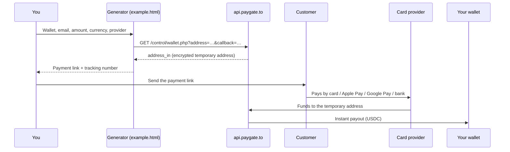

# Payment Link Generator

Free payment link and invoice generator. Create a link in a few seconds, send it to your customer, and get paid by **credit or debit card, Apple Pay, Google Pay, SEPA or local bank transfer**. Every payment is paid out **instantly to your own USDC (Polygon) wallet**.

No website, no sign up, no merchant account, no API keys and no KYC for you. Your wallet address is all you need.

🔗 **Use it online:** [https://paygate.to/payment-link/](https://paygate.to/payment-link/)

This repository contains the same generator as a single, self-contained HTML page ([`example.html`](example.html)) that you can host yourself, restyle, or add to your own site.

---

## Contents

- [Who it is for](#who-it-is-for)
- [How it works](#how-it-works)
- [Quick start](#quick-start)
- [The form](#the-form)
- [Providers, currencies and minimum amounts](#providers-currencies-and-minimum-amounts)
- [What you send to your customer](#what-you-send-to-your-customer)
- [Getting paid and tracking payments](#getting-paid-and-tracking-payments)
- [Customizing the generator](#customizing-the-generator)
- [API endpoints used](#api-endpoints-used)
- [Good practice and security](#good-practice-and-security)
- [Troubleshooting](#troubleshooting)
- [FAQ](#faq)
- [Related projects](#related-projects)

---

## Who it is for

- **Freelancers and merchants without a website** who want to send an invoice and get paid by card.
- **Sellers on social media, chat apps or marketplaces** who need a one-off payment link.
- **Developers** who want a minimal, readable example of the PayGate.to card API (two GET requests, no backend).

If you run an online shop, use one of the ready-made plugins instead (WooCommerce, Easy Digital Downloads, WHMCS, FOSSBilling, Paymenter, OpenCart, PrestaShop, Magento): [https://paygate.to/instant-payment-gateway/](https://paygate.to/instant-payment-gateway/)

## How it works

1. You fill in the form: your payout wallet, the customer's email, the amount, the currency and a provider.
2. The page asks PayGate.to for a **temporary, encrypted receiving address** for this payment (`wallet.php`).
3. The page builds the **payment link** with that address and shows it, together with a **tracking number**.
4. You send the link to your customer. They pay on the licensed provider's secure page by card, Apple Pay, Google Pay or bank transfer. The provider verifies the customer (this usually takes about 2 minutes).
5. The provider sends the funds to the temporary address, and they are **forwarded instantly to your wallet**.



Each link gets its own temporary address, which keeps your main wallet private and lets each payment be detected precisely.

## Quick start

### Use the hosted version

Open [https://paygate.to/payment-link/](https://paygate.to/payment-link/), fill in the form and copy your link. Nothing to install.

### Host it yourself

1. Download [`example.html`](example.html) (or clone this repository).
2. Put it on any web server, for example your existing website, GitHub Pages, Netlify or Cloudflare Pages.
3. Open it in a browser and create a link.

To try it on your computer, serve the folder over HTTP instead of opening the file directly (some browsers block requests from `file://` pages):

```bash
git clone https://github.com/paygate-to/payment-link-generator.git
cd payment-link-generator
python3 -m http.server 8000
# then open http://localhost:8000/example.html
```

The page has no build step, no backend and no external files: its styles and icons are inside the HTML. It only needs the browser to reach `api.paygate.to`.

## The form

| Field | What to enter |
|---|---|
| **Merchant or Freelancer Wallet Address (Receiver)** | Your **USDC (Polygon)** wallet address, starting with `0x`. Use a self-custodial wallet you control (Trust Wallet, MetaMask, Rabby, a hardware wallet). Never use an exchange deposit address. |
| **Customer or Payer Email** | The email of the person who will pay. It is passed to the payment provider. |
| **Amount to pay** | The amount the customer pays, in the currency below, for example `49.90`. To pass card fees on to the customer, enter a slightly higher amount. |
| **Currency** | `USD`, `EUR`, `CAD`, `INR`, `GBP` or `SEK` (see the restrictions below). |
| **Provider** | **Multi Hosted Providers** (default) shows the customer a page with every provider that works for their country, amount and currency. You can also pick one provider; the list is loaded live and only shows providers that are currently active. |

## Providers, currencies and minimum amounts

The provider list is loaded from the live [provider status endpoint](https://api.paygate.to/control/provider-status) every time the page opens, so it is always current. Only providers with the status `active` are shown.

**Minimum amounts** differ per provider and are checked before a link is created. The **Multi Hosted Providers** option has a minimum of **1** in the chosen currency. See the current list of providers and their minimums: [https://paygate.to/instant-payment-gateway/#minimumorder](https://paygate.to/instant-payment-gateway/#minimumorder)

The generator also checks these currency rules before creating a link:

| Provider id | Currencies accepted by the generator |
|---|---|
| `wert`, `transfi`, `robinhood` | USD only |
| `stripe` | USD or EUR |
| `upi` | INR only |
| `interac` | CAD only |
| `klarna` | SEK only |
| `ideal` | EUR only |
| All other providers and **Multi Hosted Providers** | Any currency in the list |

Provider rules can change. The [API documentation](https://paygate.to/docs/payment-gateway-api/) is the reference: if a provider's currency support changes there, update the checks in `example.html` to match.

> 📌 Due to UK FCA rules, some providers may apply a 24-hour cooling-off period to UK customers before their first purchase. Choosing a provider such as Revolut lets UK customers pay without waiting.

## What you send to your customer

After you submit the form, the page shows two values, each with a copy button:

| Value | What it is |
|---|---|
| **Payment Link** | The link your customer opens to pay. Send it by email, chat or text message. With **Multi Hosted Providers** it opens the hosted page (`checkout.paygate.to/pay.php`), where the customer chooses how to pay; with a single provider it opens that provider directly (`checkout.paygate.to/process-payment.php`). |
| **Tracking Number** | The encrypted reference of this payment (`address_in`). Keep it: you need it to look up the payment and the payout later. |

Create a **new link for every payment and every customer**. A link is tied to its own temporary address, and reusing one link for several customers can get it blocked.

## Getting paid and tracking payments

- **Payouts are instant.** As soon as the provider settles the payment, the funds are forwarded to the wallet you entered.
- **Payout coin.** Payouts are usually sent in USDC on Polygon. Some providers pay out in USDT (Polygon or BEP-20), ETH or POL instead; the same `0x` address receives all of them, which is another reason to use a self-custodial wallet.
- **Track a payment.** Paste the tracking number into the tracker at [https://paygate.to/instant-payment-gateway/#track](https://paygate.to/instant-payment-gateway/#track) to see the payment and payout on the blockchain.
- **Fees.** 1% plus the provider's fee, deducted from the payment. There are no monthly fees and no rolling reserve.
- **No chargebacks.** Payments are final. The licensed provider verifies the customer and handles any disputes.

## Customizing the generator

Everything lives in one file, so changes are quick.

### Add or remove currencies

Edit the `<select id="currency">` options. For example, to add Swiss francs:

```html
<option value="CHF">CHF</option>
```

If you add a currency, check that the providers you offer support it (see the table above).

### Change the default provider

The first option of `<select id="provider">` is the default. Keep **Multi Hosted Providers** first unless you always want to send customers to the same provider.

### Use your own domain (white-label)

You can serve both the API and the checkout from your own domains, so customers never see `paygate.to`:

1. Follow the [custom domain guide](https://paygate.to/white-label-api-custom-domain-guide/) to set up your domains, and optionally get your free DDoS-protected API endpoint (for example `api-yourshop-….paygate.to`).
2. In `example.html`, replace `api.paygate.to` with your API domain and `checkout.paygate.to` with your checkout domain. Paths, parameters and responses stay the same.
3. For the hosted provider page, you can also add `&domain=checkout.yourdomain.com` to the `pay.php` link so the page itself uses your domain.

### Get notified on your own server

When the page creates the temporary address it passes a **callback URL**. In `example.html` this is a unique PayGate.to tracking URL:

```js
const payoutTrackingId = `https://paygate.to/payment-link/invoice.php?payment=${Date.now()}_${Math.floor(Math.random() * 9000000) + 1000000}`;
```

If you want your own system to be told when a payment arrives, replace it with a URL on your server. Keep a **unique parameter** in it for every link (for example an invoice number): reusing the same callback URL returns the same temporary address.

```js
const payoutTrackingId = `https://yourdomain.com/paygate-callback.php?invoice=${invoiceNumber}`;
```

PayGate.to then calls that URL with a GET request when the payment is made, adding the payment details (`value_coin`, `coin`, `txid_in`, `txid_out`, `address_in`, `value_forwarded_coin`, `address_out`). Callbacks are signed by PayGate.to; verify them before you mark an invoice as paid. The official [PHP SDK](https://paygate.to/docs/sdk/php/) and [Node.js SDK](https://paygate.to/docs/sdk/node/) do this for you. See the [Callback Event documentation](https://paygate.to/docs/payment-gateway-api/) for every field.

### Styling

The page looks like the generator on paygate.to. Its stylesheet is in the `<style>` block at the top of `example.html`: change the colours in `:root`, or remove the block and style the form, the result fields (`.copy-text`) and the spinner (`.spinner`) with your own site's CSS.

## API endpoints used

| Step | Request | Purpose |
|---|---|---|
| Page load | `GET https://api.paygate.to/control/provider-status` | Lists providers, their status and minimum amounts. |
| Create the address | `GET https://api.paygate.to/control/wallet.php?address={your wallet}&callback={url-encoded callback URL}` | Returns `address_in` (encrypted temporary address used in the link), `polygon_address_in` (the same address, readable, for tracking), `callback_url` and `ipn_token`. |
| Payment link (all providers) | `https://checkout.paygate.to/pay.php?address={address_in}&amount={amount}&provider=hosted&email={email}&currency={currency}` | Hosted page where the customer picks a provider. |
| Payment link (one provider) | `https://checkout.paygate.to/process-payment.php?address={address_in}&amount={amount}&provider={provider id}&email={email}&currency={currency}` | Sends the customer straight to the chosen provider. |

Full reference: [Payment Gateway API documentation](https://paygate.to/docs/payment-gateway-api/).

## Good practice and security

- **Use a self-custodial USDC (Polygon) wallet** that you control. Never use an exchange deposit address, and never paste a token contract address.
- **One link per payment.** Do not reuse a payment link or a callback URL for different customers.
- **Open links directly.** Payment links must not be shown inside an iframe; the customer has to be sent to the licensed provider's page.
- **Check the amount you received.** If you use your own callback, compare `value_coin` with the invoice total before you deliver, and verify the callback signature.
- **Keep the tracking number** for every link you send, so you can trace a payment if a customer contacts you.

## Troubleshooting

| Message or problem | What to do |
|---|---|
| *Invalid payout wallet. Please insert a valid USDT (Polygon) wallet address.* | Check the wallet: it must be a Polygon address starting with `0x`, copied in full. |
| *Minimum amount for … is …* | The amount is below that provider's minimum. Raise the amount or choose **Multi Hosted Providers** or another provider. |
| *… supports USD currency only* (or another currency) | That provider does not accept the chosen currency. Change the currency or the provider. |
| *An error occurred while processing the request* | The API could not be reached. Check your connection and try again. If you host the page yourself, make sure it is served over `http(s)://`, not opened as a file. |
| The provider list only shows **Multi Hosted Providers** | The provider list could not be loaded (network or content blocker). You can still create links with **Multi Hosted Providers**. |
| The customer paid but you did not receive the payout | Look up the tracking number in the [payment tracker](https://paygate.to/instant-payment-gateway/#track). If the payment is not there, contact [support](https://t.me/PayGate_to) with the tracking number. |

## FAQ

**Do I need an account or KYC?**
No. You do not sign up and you do not share any documents. Your wallet address is enough.

**Does my customer need a crypto wallet?**
No. Your customer pays in their own currency by card, Apple Pay, Google Pay or bank transfer, like any online payment. Only you receive crypto (USDC).

**How long does a payout take?**
Payouts are sent automatically as soon as the provider settles the payment, usually within minutes.

**Can I use it for subscriptions?**
Each link is a single payment. For repeat billing, create a new link for each invoice.

**Is any business allowed?**
High-risk business models are accepted, but some businesses are prohibited. Check the [prohibited business list](https://paygate.to/instant-payment-gateway/#prohibited) before you start.

## Related projects

- **Plugins and modules** for WooCommerce, Easy Digital Downloads, WHMCS, FOSSBilling, Paymenter, OpenCart, PrestaShop and Magento: [https://paygate.to/instant-payment-gateway/](https://paygate.to/instant-payment-gateway/)
- **Crypto payments** with instant payouts for Bitcoin, Solana, Monero, Zcash and more: [https://paygate.to/crypto-payment-gateway-no-kyc-instant-payouts/](https://paygate.to/crypto-payment-gateway-no-kyc-instant-payouts/)
- **API documentation:** [https://paygate.to/docs/payment-gateway-api/](https://paygate.to/docs/payment-gateway-api/)
- **Support:** [Telegram](https://t.me/PayGate_to)

---

All payments are processed by third-party licensed payment providers. PayGate.to provides the software and API that connect them; see the [terms of use](https://paygate.to/info/terms/).
